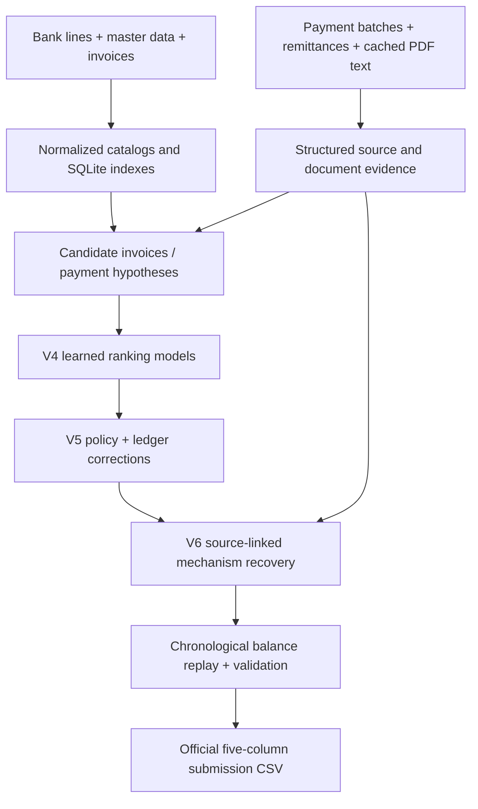

# Bank Reconciliation Hackathon
### Evidence-aware cash application across countries, formats, and payment mechanisms

**Team:** **Jiahua Tang** and **Wuqian Ma**  
**Best reported LIVE score:** **81.39 / 100 (V6)**  
**Scope:** **203,083 LIVE bank transactions**, all covered in the validated V6 submission

**FINAL execution:** the self-contained [final-system/](final-system/README.md) folder contains the frozen model, source code, base masters and runner. When the unseen archive arrives, run `python3 final-system/run_final.py --archive /path/to/bankrec-final.tar.gz`. It produces root `final-submission.csv`, with resumable phase-only processing and no new training or scoring experiment. VV1's database migration has been stopped.

**FINAL submission generated:** [final-real-submission.csv](final-real-submission.csv) covers **all 220,256 FINAL bank transactions** in **678,040 rows**, with zero missing. Runtime was about 20 minutes; all bank lines received frozen-model inference. See [execution details](final-system/FINAL_EDITION_001.md) and [edition metadata/feedback](submission/final-strategy/README.md). FINAL score is not available locally.

> **Project in one sentence:** We reconcile bank transactions with invoices and other accounting records by combining structured payment evidence, multilingual document extraction, accounting rules, a learned candidate ranker, and a state-aware ledger—rather than simply matching similar names and amounts.

## 1. The challenge

A bank transaction does not necessarily correspond to a single invoice. One transfer can clear multiple invoices, deduct credit notes, settle an instalment, come from a parent company or payment intermediary, or reverse an earlier payment. The relevant evidence may be spread across banking records and separate PDF, TXT, CSV, or XLSX files.

The task is to produce the organizer's five-column reconciliation output:

```text
bank_txn_id,item_id,amount,category,exception
```

For item allocations, `amount` is in the **item's currency**. Transactions without an applicable invoice may instead require a non-item `category`. Discounts, partial settlements, returns, bank charges, FX differences and other cases require the appropriate `exception`.

An illustrative payment can be:

```text
Invoice A                 +1,000 EUR
Credit note B               -100 EUR
                           ---------
Incoming bank transfer       900 EUR
```

A direct amount-equality lookup misses this allocation. The solver needs relationships, signed accounting arithmetic, and evidence that the documents actually belong together. Matching a coincidentally equal amount is not enough.

### Available evidence

| Source | Information used |
| --- | --- |
| Bank transactions | Date, cash amount, currency, direction, account, counterparty, reference text |
| AR/AP invoices and credit notes | Official item IDs, printed document numbers, legal entities, parties, issue dates, amounts |
| Master data | Customers, suppliers, groups, bank accounts, terms, FX rates and categories |
| Payment runs and batches | Evidence connecting one bank-side settlement to multiple underlying documents |
| Remittance advice (PDF/TXT/CSV/XLSX) | Invoice lists, credit deductions, payer references and settlement explanations |
| Invoice PDFs | Service periods, replacement clauses, advances, instalments and retention wording |
| Opening balances and payment history | Which amounts can still be cleared, and which prior events were returned or duplicated |

This is a **synthetic financial dataset**, but the observable documents still need to be interpreted through the competition's official accounting policies. Repeated text templates can provide useful evidence; they are not a license to guess hidden answers.

## 2. Solution overview

Our strongest edition is a **hybrid, evidence-first reconciliation system**. It keeps deterministic financial logic around a supervised ranking model and adds targeted repairs for business mechanisms missing from the model's original candidate set.



The implementation is designed for **offline batch reconciliation**. It reuses parsed sources and prior fitted models instead of sending every transaction to an LLM.

### Core decisions

1. **Resolve entities before amounts.** Use a party's identity, aliases, IBAN, mandate, legal entity, group relations and document references to scope candidates. The payer may differ from the debtor.
2. **Treat structured payment files as stronger evidence than approximate similarity.** Payment runs, remittance rows, card orders and cheque records can identify an entire group that the bank memo does not show.
3. **Preserve the distinction between cash and clearing.** A partial cash amount may still fully clear an item under a valid discount/fee/withholding policy; a different payment may leave an open residual.
4. **Keep chronological state.** Partial payments consume remaining balances, while supported returns reopen the original allocation. Duplicate payments must not silently clear the same invoice twice.
5. **Use machine learning only after candidate generation.** A ranker cannot select a correct item that was never retrieved.
6. **Validate the final submission against the organizer's contract.** Coverage, identifiers, monetary formatting, labels and schema are checked before release.

## 3. Tech stack and models

| Layer | Technologies / approach |
| --- | --- |
| Data processing | **Python**, CSV/XLSX/TXT parsers, streamed processing |
| Document extraction | Native PDF text extraction (including **pypdf** in the independent solver), content-hash-based text caches, multilingual phrase rules |
| Persistent retrieval | **SQLite**, indexed item/reference/party/amount lookup |
| Financial reasoning | Deterministic accounting policies, integer-cent arithmetic, FX conversion, open-item balance ledger |
| Supervised ML | **scikit-learn `HistGradientBoostingClassifier`** for allocation ranking and complete-payment decisions |
| LLM assistance | Small, bounded reviews of ambiguous evidence in V5; archived decisions replayed deterministically |
| Evaluation | Organizer's scorer, unit tests, validation reports, per-scenario feedback and versioned outputs |

**V4 model details.** Two gradient-boosted classifiers were trained: one scores candidate item allocations and another scores complete payment hypotheses. The models use **49** and **81** features respectively, with features such as reference agreement, party similarity, amount ratios, invoice age, currency, payment terms and source signals. The training procedure used a temporally separated TRAIN sample, with **70,500 sampled bank lines before episode purging**, and a **7,500-line January–May 2025 evaluation cohort**. Full setup and caveats: [V4 TRAIN report](https://github.com/WuqianMa/hackthon/blob/q/version-4/TRAIN_RESULTS.md).

**LLM scope.** V5 used a bounded agent-assisted review, not an LLM call on every LIVE transaction: **48 LIVE cases were reviewed**, and **23 decisions changed**. The production Python pipeline replays archived reviews and has no autonomous live provider client. V6 made **no new LLM calls and performed no retraining**.

## 4. How our strategy evolved

We maintained two experimental approaches in parallel rather than forcing an early merge.

### Main scoring lineage: `q` branch

| Edition | Reported LIVE score | Main change |
| --- | ---: | --- |
| **V3** | **77.46** | Deterministic references, structured sources, accounting policies and initial balance handling |
| **V4** | **79.05** | Two supervised gradient-boosted models rank item and payment hypotheses |
| **V5** | **79.34** | Better amount/exception semantics, ledger-aware repairs, targeted source recovery and limited LLM review |
| **V6** | **81.39** | Source-linked returns, multilingual PDF facts, named service months, replacement invoices, credit-note netting, advance deductions and bounded partial groups |

**V6 improved by +2.05 points over V5 and +3.93 over V3** on the reported LIVE website scores. All LIVE results above were recorded from website feedback supplied to the project; the LIVE hidden labels are not available to the inference pipeline.

A key V6 discovery was that document **semantics** often mattered more than a generic score threshold: choosing the invoice for the explicitly named *service month* instead of the nearest same-amount invoice raised that segment's reported accuracy from **49.3% to 89.2%**.

Other examples of V6's deterministic recovery include linking a rejected supplier transfer to its individual original payment documents, using a cancelled invoice number to find its replacement, matching a credit note against its parent invoice with signed cash arithmetic, and recognizing a documented advance deduction.

Implementation and evidence: [V6 strategy](https://github.com/WuqianMa/hackthon/blob/q/version-6/STRATEGY.md) · [V6 results](https://github.com/WuqianMa/hackthon/blob/q/version-6/RESULTS.md) · [LIVE website feedback](https://github.com/WuqianMa/hackthon/blob/q/submission/v6-strategy/feedback.md).

### Independent `jiahua` branch

The parallel implementation focuses on **high-precision deterministic reconciliation**, combining master-data profiling, party/IBAN lookups, source batches, remittance parsing, credit netting, constrained candidate search and chronological balance resolution.

Its reported **best LIVE score is 75.29** (V6/V7). The rule-based path exposed an important tradeoff: very high allocation precision (**95.7%**) could still score below the more recall-oriented hybrid approach when many correct invoice groups were not generated. Its sample results and LIVE iterations are documented separately; they should not be conflated with V6 on the `q` branch.

See [independent matcher](https://github.com/WuqianMa/hackthon/tree/jiahua/bankrec-improved) and [LIVE report](https://github.com/WuqianMa/hackthon/blob/jiahua/bankrec-improved/LIVE_REPORT.md).

## 5. Best-result evaluation

**V6 LIVE website feedback:**

| Metric | V6 |
| --- | ---: |
| Composite score | **81.39 / 100** |
| Allocation F1 | **85.4%** |
| Allocation precision | **94.9%** |
| Allocation recall | **77.7%** |
| Whole-transaction accuracy | **88.7%** |
| Exception macro-F1 | **60.3%** |
| Amount-weighted accuracy | **83.7%** |
| Bank transactions covered | **203,083 / 203,083** |
| Submission rows | **643,231** |

The official composite weights allocation F1 (50%), transaction accuracy (30%) and exception macro-F1 (20%). The local V6 development score (**81.41 on 7,500 labeled TRAIN lines**) is a *different evaluation*, not an additional LIVE website result.

V6's submission passed the official schema/parser checks with no hard validation errors. **Aggregate over-clearing diagnostics remain**, however: these are modeling limitations and must not be confused with zero accounting conflicts.

### What remains difficult

The two weakest major LIVE groups after V6 are:

| Scenario | Reported V6 accuracy |
| --- | ---: |
| **N-to-M** (multiple bank lines against multiple invoices) | **24.1%** |
| **Invoice + credit-note groups** | **47.7%** |

Both problems often require recovering a **complete, connected payment episode**, not picking an invoice for each bank line independently. No model can repair a missing hypothesis purely by ranking the proposals it receives.

For context, the V4 temporal test found that only **22,383 / 26,528 (84.375%)** correct item/amount pairs were present in the generated candidate pool. Candidate coverage is therefore a first-class problem.

## 6. Next: VV1, a country- and language-aware evidence database

**VV1 is a proposed next edition—not a completed or scored version.**

Our next hypothesis is that this synthetic dataset's recurring document templates can reveal financial relationships that are obscured by fragmented file formats. The same payment mechanism may be expressed differently across languages, banks, countries and document types.

We want to transform extracted evidence into a **queryable relational model**, rather than re-reading PDF/TXT/XLSX data within separate matching strategies.

Proposed VV1 steps:

1. **Reuse existing extraction.** Import cached native PDF text, normalized CSVs and parsed payment sources; avoid bulk re-extraction when file hashes are unchanged.
2. **Tag documents independently by country and language.** Country should come from grounded legal-entity/issuer/source metadata where available; language should be detected from the text. One language does not imply one country.
3. **Preserve structured facts and provenance.** Store the actual service period, discount, instalment amount, replacement reference, advance, credit link and the source text span—not only Boolean flags.
4. **Build explicit relationships.** Model invoice ↔ credit note, payer ↔ debtor, parent ↔ subsidiary, advice ↔ payment group and return ↔ original settlement.
5. **Generate connected payment hypotheses.** Retrieve candidate *groups* spanning several bank lines and items, then validate them using integer-cent accounting identities, dates, currencies, source evidence and open balances.
6. **Measure improvements without losing strong cases.** Compare with frozen V6 on candidate recall, N:M coverage, credit-net groups, official score, runtime and regression controls.

The starting database can remain **SQLite**. A graph-like relationship model does not require a separate graph database until a measured bottleneck justifies one.

## 7. Code and reproduction

The repository's **`main` branch is the project landing page**. The actual solver implementations and recorded artifacts are on the two development branches:

- **[`q`](https://github.com/WuqianMa/hackthon/tree/q):** V3–V6 hybrid strategy, evaluation reports and versioned LIVE submissions.
- **[`jiahua`](https://github.com/WuqianMa/hackthon/tree/jiahua):** independent rule-based solver, profiling, tests and evaluation reports.

To inspect or reproduce the current best-scoring pipeline, start with the `q` branch:

```bash
git clone https://github.com/WuqianMa/hackthon.git
cd hackthon
git switch q

python3 -m venv .venv
.venv/bin/python -m pip install -r requirements.txt
.venv/bin/python -m pip install -r version-4/requirements.txt

# Uses the organizer's source archives, existing caches,
# and frozen V4/V5 artifacts described in the versioned docs.
.venv/bin/python version-6/run.py --phase test
.venv/bin/python version-6/run.py --phase live
.venv/bin/python version-6/run.py --publish
```

**Important:** The V6 reproduction commands depend on the organizer's data archives, the local extracted catalogs/PDF caches, and the frozen earlier-edition predictions/model. A fresh clone alone does **not** supply all of these inputs. See [V6 README](https://github.com/WuqianMa/hackthon/blob/q/version-6/README.md) and [the pipeline runbook](https://github.com/WuqianMa/hackthon/blob/q/README.md) for the data layout and prerequisites.

For the independent strategy:

```bash
git switch jiahua
python3 -m pip install -r bankrec-improved/requirements.txt
python3 bankrec-improved/matcher.py --mode full --out sample_improved.csv.gz
```

This command likewise requires the organizer's sample and master-data package at the documented local paths. See [jiahua README](https://github.com/WuqianMa/hackthon/blob/jiahua/bankrec-improved/README.md) for data paths, scoring and full TRAIN runs.

### Reproducibility and evaluation boundaries

- The organizer's `POLICIES.md`, `FORMAT.md` and scorer define the authoritative task and accepted output.
- TRAIN golden labels are used for training/evaluation, **not** as LIVE inference inputs.
- Repeated tuning on an inspected development set is not blind validation.
- Source and artifact hashes, tests, versioned CSVs, scenario metrics and release manifests are retained on the implementation branches.
- VV1 country/language rules and broader N:M allocation are **future work**, not claims about the current V6 implementation.

## 8. Team

**Jiahua Tang** · **Wuqian Ma**

Two complementary experimental tracks informed the project: a high-precision rules-and-evidence solver and a hybrid ranking-plus-accounting-policy pipeline. The shared objective is to make reconciliation **accurate, explainable and reproducible** even when payment evidence is spread across different documents, languages and legal entities.
