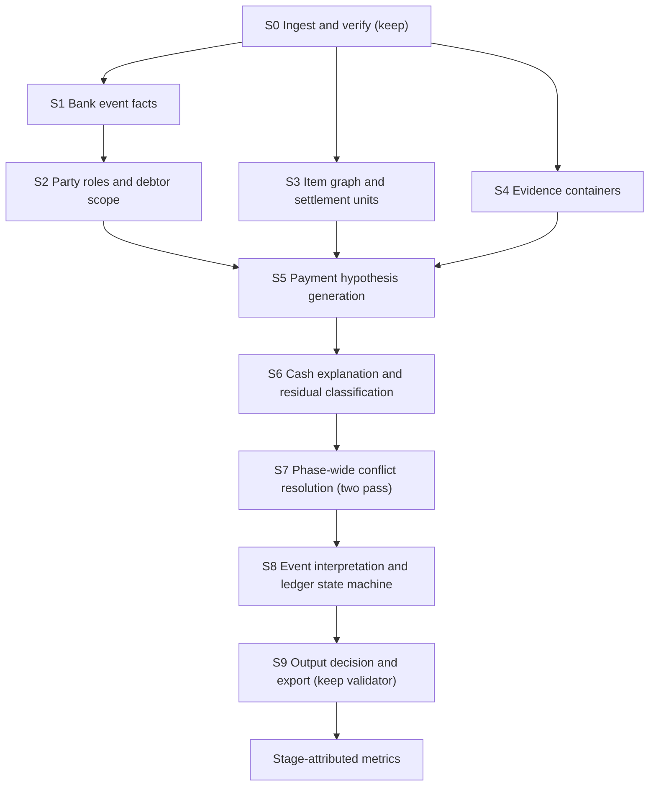

# Non-simplified task chain — specification

Companion to `../strategy_proposals/2026-11-07_gemini_strategy.md`. Status: **design proposal only**. Nothing here is implemented; no solver code was changed and no pipeline was run.

## 0. The simplification being removed

The baseline (`bankrec/engine.py`, tag `v0.1.0-baseline`) effectively runs this chain per bank line:

```
text regex category?  →  structured group (all-or-nothing)  →  reference token → single item
                      →  party + equal amount (FIFO)        →  bounded subset  →  UNIDENTIFIED
then: policy(item, cash) → exception label → mutate balance immediately
```

Four things are collapsed that the official rules (`POLICIES.md` §1–§5) keep distinct:

| Collapsed in baseline | Distinct in the rules | Code location |
|---|---|---|
| Payer = invoice customer | Remitter, intermediary (confirming bank, factor, agency, payment factory) and **debtor whose items are cleared** (§5.1, §5.2) | `engine.py:144-146`, `catalog.identify` |
| Item = one open amount | An invoice can be settled in **planned tranches**: instalments, retention release, net-of-advance, dispute residual (§3, §5.8) | `catalog.py:80-83` initialises `balance=total`; PDF facts are boolean flags (`catalog.py:136-141`) |
| Item list = flat | Items are **related**: credit→invoice (`related_document`), replacement→cancelled, return→original, re-presentation→return (§5.7, §5.9, §5.10) | `related_document` not loaded; credits excluded from subset pool (`engine.py:289`) |
| Payment file = one cash total | Files have **grouping levels**: run, maturity date, beneficiary/EndToEndId (§5.3, DATA_DICTIONARY `run_type`) | `sources.py` groups by run; `engine.py:194` compares the whole group to the line |

…and three process shortcuts:

1. **Decision before explanation.** `policy()` labels the cash difference of whatever item was found, before anyone checks whether the item set is complete (`engine.py:296` + `:106` → false `OVERPAYMENT`).
2. **Streaming, not batch.** Lines are processed chronologically and committed immediately (`engine.py:338`, `cli.py:134`), although the whole phase is available offline and advices can arrive *after* the cash (§5.4).
3. **Refusal as the default outcome.** Any tie, any unresolved group entry, any ambiguity ends in `UNIDENTIFIED` (`engine.py:171`, `:199-200`, `:218`, `:267`, `:341`).

The chain below restores each distinction as an explicit stage with an explicit output object.

## 1. The chain



Each stage has one owner module, a typed output, and a stage-level metric that can be measured on the starter sample.

---

### S1 — Bank event facts (`bankrec/events.py`)

**Input:** normalized bank line + raw statement record where it adds information.
**Output:** `BankEvent`

| Field | Meaning |
|---|---|
| `direction`, `amount_cents`, `currency`, `orig_amount`, `orig_currency` | Cash, kept separate from any item amount |
| `channel_candidates` | Ranked set from {`TRANSFER_IN`, `TRANSFER_OUT`, `DD_BATCH_CREDIT`, `DD_RETURN`, `CARD_SETTLEMENT`, `CHEQUE_DEPOSIT`, `CHEQUE_RETURN`, `PAYMENT_RUN_DEBIT`, `CONFIRMING_DEBIT`, `TRANSFER_REJECTED`, `NON_ITEM`} |
| `remitter_span` | The text region that names the payer/beneficiary (N43 record-23 payer region, MT940 :86: subfield, camt `Dbtr/Cdtr`) |
| `intermediary_markers` | `CONFIRMING … ORD. <x>`, `EXPTE …`, factor names |
| `reference_spans` | Each token with its **form**: `complete`, `suffix_under_anchor`, `truncated_prefix`, `digits_only`, `po_like`, `voucher_like` |
| `period_phrase` | Service month (“SERVICIOS MAYO 2025”, “MANT. MAYO 25”) |
| `charge_markers`, `return_markers` | SHA/BEN/CHGS; R-transaction / impagado / chargeback |
| `category_evidence` | Narrative category matches, **as evidence, not as an early return** |

Key change: **channel first, category second.** Today `classify()` runs before any structured evidence (`engine.py:331`), so a card settlement mentioning `COMISION` can be shadowed by `BANK_FEES` (contradicts §4). In the chain, a category is just one more hypothesis competing in S6/S7.

**Stage metric:** channel accuracy against golden-derived channel (item prefix + container membership); reference-form coverage (share of golden documents whose printed number is reachable from some span after form expansion).

---

### S2 — Party roles and debtor scope (`bankrec/roles.py`)

**Output:** `PartyRoles = {remitter_candidates[], intermediary?, debtor_scope[]}` — each candidate with the evidence channel that produced it.

Resolution order, strongest first:

1. Exact keys: counterparty IBAN, SEPA mandate, debtor IBAN in DD batch, beneficiary IBAN in payment run.
2. Container payer: remittance-advice `payer_name` (index.csv) once an advice is linked.
3. Truncated-name match of `remitter_span` against `customers.name/trade_name` and `suppliers.name`, entity-scoped (longest normalized prefix; field widths 16/35/38 per §5.5).
4. Intermediary unwrapping: `CONFIRMING … ORD. <customer>` → the ordered customer is the debtor; `EXPTE` → collection-agency payment of old items.

Then **expand** remitter → debtor scope, using only master relationships:

- `parent_customer_id` / `group_id` (§5.1) — parent pays for subsidiaries.
- Payment factory: ES00 pays supplier items of ES01, ES02, PT01 (§5.2).
- Both old and new collection account are valid for IT01 after 2026-02-01 (§5.11).

Ambiguity rule: **abstain from a party, not from the allocation.** If two remitters remain, both scopes go forward and S6 decides using cash closure and references.

**Stage metric:** debtor-scope recall (golden items' party ∈ scope) and mean scope size, stratified by `statement_format`. Claude's measurement (amount is unique within the correct party in 86.5% of single-item cases vs 2.2% without it) makes this the highest-leverage stage metric.

---

### S3 — Item graph and settlement units (`bankrec/graph.py`)

The core representational change. Items stay as the submission unit, but matching targets become **settlement units** derived from item facts:

| Item situation (source) | Settlement units generated | Exception if that unit is paid (POLICIES §3) |
|---|---|---|
| Plain invoice | 1 unit = open amount | empty |
| Instalment plan in PDF (“3 vencimientos”) | n units with the PDF amounts; last flagged `final` | `PARTIAL` for 1…n−1; empty for final |
| Guarantee retention 5–10 % in PDF | unit A = total − retention; unit B = retention (release ≈ 12 months later) | A → `PARTIAL`; B → empty |
| Advance to deduct (“a deducir anticipo”) | unit = total − advance; residual unit | `PARTIAL` |
| After `SHORT_DISPUTE` | residual unit = disputed amount | later settlement → empty |
| After unplanned partial (“A CUENTA”) | residual unit = remaining balance | remainder → empty |
| Early-payment discount terms | alternate amount of the full unit = total × (1 − pct) within booking ≤ issue + days + 3 | `SHORT_DISCOUNT` (full clear) |
| Withholding customer (MX/BR/MA, *customer-evidenced*) | alternate amounts at 1.25 / 1.5 / 10 % of total | `SHORT_WITHHOLDING` (full clear) |

Edges:

- `credit → invoice` from `credit_notes.related_document` (currently dropped).
- `replacement → cancelled` from “anula y sustituye” (already parsed; keep).
- Rappel credit note: `offset` vs `paid_out` mode from its PDF (§5.9).
- `dd_receipt → batch`, `return → original allocation`, `re_presentation → return` (§5.10).

History certainty: every unit carries `history = known | assumed`. Opening items without invoice metadata use `assumed` terms; S6 may not award `SHORT_DISCOUNT` on assumed terms without corroboration.

**Stage metric:** unit-amount coverage — share of golden `(item, amount)` pairs whose amount equals some generated unit or alternate amount within scorer tolerance.

---

### S4 — Evidence containers (`bankrec/containers.py`, evolving `sources.py`)

A container is a source file that lists documents and implies a cash total. Each parser must **reconcile itself** before its output is trusted:

| Container | Parsed lines | Grouping levels exposed | Acceptance check (no golden needed) |
|---|---|---|---|
| Remittance advice (PDF/CSV/XLSX/text) | doc ref or voucher, gross, signed deduction, reason, net | advice | Σ net = stated total; count matches; currency consistent |
| Payment run | document, type, signed amount, beneficiary, EndToEndId, transfer_amount | run / maturity date / beneficiary / EndToEndId | Σ documents per level = transfer_amount per level |
| Direct-debit batch | receipt, mandate, debtor, amount, re_presentation | batch / receipt | Σ receipts = batch_total |
| Card settlement | orders at gross | settlement | gross − fee = net credit |
| Cheque deposit | cheques | deposit / cheque | Σ cheques = deposit |

The bank line selects the level: a `TRANSFER_OUT` with an EndToEndId matches the EndToEndId level; a `CONFIRMING_DEBIT` matches the maturity-date level; an aggregated debit matches the run. Codex's case `BT-2025-0163248` (two rows under `CF010025061071-0062` totalling the bank cash) is exactly a level-selection failure.

A parser that finds rows but fails its own total check is reported as `parse_unreconciled`, never silently accepted (Codex's case F: deduction read as paid amount).

**Stage metric:** container reconciliation rate per layout; share of golden multi-item transactions whose full item set equals one container level.

---

### S5 — Payment hypothesis generation (`bankrec/hypotheses.py`)

**Output:** a bounded set of `PaymentHypothesis` per bank line. Nothing is committed here.

```text
PaymentHypothesis
  bank_txn_id
  generator            container | reference | party_amount | service_month | scoped_subset | non_item | unidentified
  debtor_scope         from S2
  members              [(item_id, unit_id, role=invoice|credit, contribution_cents, item_currency)]
  cash_equation        Σ signed contributions (converted)  vs  bank cash
  residual_cents       bank cash − explained
  completeness         {container_total_match, refs_covered, refs_unresolved, credits_closed}
  evidence             [(source_path, span/row, parser_version)]
  tier                 1 container-exact | 2 reference-complete | 3 party+unit-exact | 4 scoped-subset | 5 non-item | 6 unidentified
```

Generators (all run; none short-circuits the others):

1. **Container:** each container level whose cash matches → members from its lines, resolved within debtor scope. **Partial resolution is kept**: unresolved lines become `refs_unresolved` instead of discarding the whole group (replaces the `for/else` at `engine.py:197-207`).
2. **Reference:** expanded reference spans → units; multiple references form one hypothesis.
3. **Party + unit amount:** exact match of cash to a unit or alternate amount inside debtor scope; FIFO by issue date, **unless** a `period_phrase` selects the service-month invoice (§5.6).
4. **Scoped subset:** bounded subset of open units inside a *single resolved debtor scope* only; never across the entity pool (protects §3 “unidentified lookalikes”).
5. **Credit closure (applied to every hypothesis):** add open credits linked by `related_document` to member invoices, or offset-mode rappels of the same customer, when doing so closes the cash equation.
6. **Non-item:** category hypotheses from S1 evidence.
7. **Unidentified:** only generated with positive evidence (below).

**Stage metric (Claude's C5, adopted):** `pair_recall` and `group_completeness` = share of transactions whose complete golden set appears as at least one hypothesis. This is the metric that tells retrieval failures apart from selection failures.

---

### S6 — Cash explanation and residual classification (`bankrec/explain.py`)

Every hypothesis gets a residual class computed from policy arithmetic, **after** its member set is known:

| Residual situation | Class | Exception effect (POLICIES §3) |
|---|---|---|
| abs(residual) within scorer tolerance | `CLOSED` | per-unit exception from S3 table |
| Bank currency ≠ item currency, within 3 % at reference rate | `FX` | `FX_DIFFERENCE` on fully cleared invoice rows; credits empty |
| Shortfall = discount within booking window | `DISCOUNT` | `SHORT_DISCOUNT`, amount = full open |
| Shortfall = 1.25/1.5/10 % and customer-level withholding evidence | `WITHHOLDING` | `SHORT_WITHHOLDING`, amount = full open |
| Non-SEPA payer, SHA/BEN marker, ≤ 60 EUR and ≤ 2 % | `BANK_CHARGE` | `SHORT_BANK_CHARGES`, amount = full open |
| Advice states deduction with reason | `DISPUTE` | `SHORT_DISPUTE`, amount = applied |
| Excess over a **single** invoice **and** completeness proven | `OVERPAYMENT` | `OVERPAYMENT`, amount = full open |
| Excess but completeness *not* proven | `INCOMPLETE_EXCESS` | emit members; **no** `OVERPAYMENT` label; residual logged |
| Shortfall, no specific reason | `PARTIAL` | `PARTIAL`, amount = applied |

Hypotheses are then **ordered lexicographically**, not by a tuned weighted sum:

1. evidence tier (container > complete reference > party+unit > subset > non-item > unidentified);
2. residual class (`CLOSED`/policy-explained > `DISPUTE`/`PARTIAL` > `INCOMPLETE_EXCESS`);
3. reference coverage (unexplained reference tokens left in the bank text count against);
4. date plausibility (container date window, due dates);
5. policy tie-break (FIFO / service month) and deterministic id order.

Lexicographic ordering keeps every comparison explainable and leaves almost no free weights to overfit — the baseline's 5/3/10/10/2 and 30/15/10/5/20 weights disappear.

---

### S7 — Phase-wide conflict resolution, two passes (`bankrec/resolve.py`)

The phase is processed **offline as a batch**:

- **Pass A — generate.** Build hypotheses for every bank line of the phase. Advices received after the cash, returns that follow their original debit, and re-presentations are all visible.
- **Pass B — commit.** Commit tier-1 hypotheses first across the whole phase, then tier 2, and so on; within a tier, chronologically. A hypothesis whose units were consumed by a stronger commitment falls back to its next hypothesis. Returns are committed after the allocation they reverse.

This replaces “first route wins and mutates immediately” (`engine.py:335-339`) with a deterministic, auditable reservation scheme. No optimisation library is needed; it is a sorted greedy over evidence tiers, which is what Codex's “two-stage decision process” describes, made concrete.

---

### S8 — Event interpretation and ledger state machine (`bankrec/ledger.py`)

Each settlement unit has a state: `open → partially_paid → settled → (returned → reopened)`, plus `disputed_residual`. Transitions produce the exception, so labels follow from **state**, not from a fresh amount comparison:

- paying a unit already `settled` → `DUPLICATE_PAYMENT` (amount = paid again);
- paying `disputed_residual` or the remainder after a partial → empty;
- final instalment / retention release → empty;
- return → `RETURNED` on every item of the returned operation, amount = the reversed allocation.

The ledger is the only writer of balances; S5–S7 never mutate state.

---

### S9 — Output decision and export (`bankrec/export.py`, keep `validate.py`)

**When to emit an allocation vs `UNIDENTIFIED`.** `UNIDENTIFIED` is emitted only when the line has positive evidence of the profile in §3: incoming cash, **no** debtor scope resolved, **no** usable reference span, and no container link. Otherwise the best committed hypothesis is emitted, including `INCOMPLETE_EXCESS` hypotheses (members emitted, excess label withheld).

The threshold between those two outcomes is set by an explicit expected-score argument over a **non-oracle** population (see proposal §2.3), not by a confidence cut-off tuned on the sample.

Export, validation, coverage and balance replay stay exactly as in the baseline.

---

## 2. Stage-attributed metrics (the feedback loop)

Every run on the starter reports, per stage and stratified by `statement_format`:

| Stage | Metric | Needs golden? |
|---|---|---|
| S1 | channel accuracy; reference-form coverage | yes (diagnostic only) |
| S2 | debtor-scope recall; mean scope size | yes (diagnostic only) |
| S3 | unit-amount coverage | yes (diagnostic only) |
| S4 | container self-reconciliation rate per layout | **no** |
| S5 | pair_recall; group_completeness; hypotheses per line (p50/p99) | yes (diagnostic only) |
| S6–S8 | selection accuracy given golden set present; per-exception P/R/F1 | yes |
| End | official composite and components (unchanged scorer) | yes |

Plus each wrong transaction is assigned to the **earliest failing stage**. That single table replaces both the Codex scenario taxonomy and the Claude failure buckets with one causal attribution.

Golden is used to *measure* stages, never as a runtime feature.

## 3. Module map and migration

| New / changed module | Replaces | Can be introduced behind a flag? |
|---|---|---|
| `events.py` | `text_of`, `is_return`, `classify` early-return | yes |
| `roles.py` | `Catalog.identify` single-party output | yes |
| `graph.py` | flat `items` rows + boolean PDF facts | yes (units default to one per item) |
| `containers.py` | `sources.Group` single level | yes |
| `hypotheses.py` + `explain.py` | `structured`, `reference_match`, `policy` call order | yes |
| `resolve.py` | chronological commit in `reconcile` | yes |
| `ledger.py` | `Catalog.apply` | yes |

With every flag off, the chain must reproduce the baseline sample output bit-for-bit (71.32). That equivalence test is the first deliverable and protects the comparison point.
