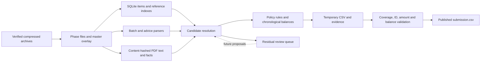

# Static bank-reconciliation system and future agent proposal

Historical baseline proposal. Following the user's 7 November workflow feedback, the active recommendation is `docs/strategy.md`, with a code/design review in `self_review/2026-11-07_baseline_review.md`. No further whole-pipeline run or solver change is implied by this report. Compare independent proposals before choosing the next strategy. The results below remain the original measured baseline.

Prepared 7 November 2026. This report is based on the actual verified docs/master archive and its small labeled dataset, followed by an operational run against the available LIVE archive. It replaces assumptions in the earlier description-only analysis with observed schemas, official policies and measured sample results.

## 1. Recommendation and delivered scope

Use a deterministic, offline reconciliation program as the submission owner. It should extract verified archives, build document/party indexes, expand payment evidence, apply the accounting policies, maintain item balances, and publish a CSV only after local validation. An agent should later supply evidence or proposed candidates to this system, with the static engine retaining control of amounts, exceptions, balances and export.

The first implementation is included in this repository. It runs from a command line, makes no model/network calls, and writes `final_submission/<phase>/submission.csv` plus validation, provenance and review artifacts. The sample is scored by the organizer's unchanged reference scorer. The available production phase is LIVE; no FINAL archive exists in this workspace. The folder name `final_submission` denotes output location, not a claim that LIVE records belong to the FINAL phase.

This is an operational baseline with measured strengths and explicit gaps. It is not yet a complete solution to all approximately 70 transaction families. In particular, passing schema and balance validation does not establish that every suggested allocation is correct, and an unresolved fallback does not establish that an item truly does not exist.

## 2. Evidence inspected and input integrity

Read in full: root `AGENTS.md`, `bank_reconciliation_challenge_analysis.md`, and the archive's `README.md`, `README_EN.md`, `POLICIES.md`, `FORMAT.md`, `DATA_DICTIONARY.md`, `starter/README.md`, `starter.py`, `score_train.py`, and `bankrec_score.py`.

All three supplied archives were SHA-256 checked before use:

| Archive | Result | Scope of exploration |
|---|---|---|
| Docs and masters ZIP, 10,432,471 bytes | Matches `210b2404…18cc1071` | Extracted; documents, masters and sample explored. |
| LIVE TAR.GZ, 87,077,114 bytes | Matches `eec490d7…0d8af520` | Used to exercise operational compatibility and generate an unlabeled submission. |
| Full TRAIN TAR.GZ, 656,976,477 bytes | Matches `163f51a8…8e3f06b8` | Integrity checked; four-year data not explored, modeled or evaluated in this iteration. |

Full checksum values are pinned in `bankrec/io.py` and recorded in run manifests. FINAL must be supplied with its actual organizer-published checksum; the program does not invent one. The existing guide is useful context, but neither its phase counts nor the earlier analysis's proposed algorithms are treated as authoritative policies.

The extraction layer supports ZIP/TAR, rejects path traversal, links and special files, writes into a staging directory, and exposes the extracted tree only after successful extraction. Raw archives are unchanged. Extracted trees are cached and treated as immutable; archive checksums are rechecked on each run. A cached extraction marker is not a per-file tamper detector: rebuilding a modified extraction requires removing that derived extraction directory first. Input CSV hashes in the completed manifest make the actual run inputs auditable.

## 3. What the small dataset actually contains

The sample is June 2025, with bank lines for DE01, ES01 and FR01. It is a useful integration fixture, not a representative replacement for four years of TRAIN or all LIVE entities.

| Sample input | Observed count |
|---|---:|
| Normalized bank lines | 8,499 |
| AR invoices | 50,775 |
| AP invoices | 13,709 |
| Credit notes, AR and AP | 1,362 |
| Golden allocation/category rows | 36,574 |
| DD receipt rows / batch groups | 5,184 / 72 |
| Card settlement groups | 84 |
| Cheque rows / deposit groups | 164 / 41 |
| Payment-run files / parsed payment groups | 4 / 2,750 |
| Actual remittance advice files | 331: 123 CSV, 123 PDF, 73 TXT, 12 XLSX |
| Document PDFs | 2,298; median size 2,685 bytes |

The directory also has a remittance `index.csv`, which explains why a raw extension inventory counts 124 CSV files rather than 123 advice CSV files. The parser excludes the index from advice documents.

Bank currencies are EUR for 8,486 lines and USD for 13. Item currencies can differ from the cash currency. Statement representations are 3,868 N43, 2,537 MT940 and 2,094 camt.053 lines. The full master snapshot has 17 entities, 47 bank accounts, 55,672 customers, 12,831 suppliers, 21 categories, 13 payment-term codes and 13,706 FX observations.

`reports/sample_profile.json` records the actual field lists and distributions. Important observed details are:

1. Large tables are `*.csv.gz`, not the plain CSV paths assumed in the brief. N43 raw filenames use `.n43`.
2. A bank line's stable key is `bank_txn_id`; printed document references require an independent lookup into `item_id`. AP references are especially non-unique across suppliers.
3. `cheque_deposits/` is a real fifth structured evidence family absent from the initial source list. APC credit notes are real items, including incoming supplier refunds that must not be categorized automatically.
4. Payment-run `document_amount` is signed for netted credits; submitted credit-note allocations remain positive. `transfer_amount` repeats across the documents of a beneficiary and must not be summed once per row.
5. Card sources contain gross, fee and net. The cash line is net, while allocation amounts are gross and the contractual fee does not create an exception.
6. Advice CSVs include a metadata row before the header and use both comma and semicolon separators. PDF/mail advice amounts use both `1,234.56` and `1.234,56` conventions. XLSX advice can omit currency, so currency cannot safely be guessed as EUR.
7. PDFs contain native text and concrete clauses for replacements, instalments, retention and advances. The current index maps and reads 1,492 document PDFs uniquely to sample items. This is evidence for native-text extraction on those documents, not proof that every document in every phase is native text.
8. The sample includes old invoices but no opening-balance snapshot. A June-only run cannot reconstruct every payment, duplicate, return or disputed remainder from prior months. Its weak history-dependent results must not be interpreted solely as a matching-model failure.

Operational checks on LIVE revealed macOS AppleDouble `._*` files with normal data suffixes. These are binary metadata and are excluded from discovery. They also revealed that cheque numbers are reused: the internal cheque key now includes account and deposit. US printed invoice numbers can be entirely numeric; the text parser accepts them. None of these observations required LIVE golden labels.

## 4. Corrections to the original proposal

The earlier analysis offered useful hypotheses but several should not become implementation commitments:

| Earlier idea | Evidence-based decision |
|---|---|
| Treat printed numbers as near-unique identifiers | Index with party/entity context and preserve all candidates. AP numbers and cheque numbers collide. |
| Use the sample discount amount from the illustration | Apply POLICIES §2–3: accepted discounts clear the **full open amount**, not the smaller cash amount. |
| Infer 99%+ native PDFs and a 2–5 minute full extraction from archive size | Use measured extraction and caching; neither percentage nor full-phase timing follows from compressed size. |
| Use Polars/DuckDB exclusively | Start with SQLite indexes and bounded candidate queries. This keeps installation simple and memory/disk behavior observable. Reconsider an analytical store after full TRAIN benchmarking. |
| Require an ML ranker immediately | First recover explicit batches, advices and references. The sample gains are already substantial without training. A ranker is a later optional candidate scorer. |
| Guess from a globally unique amount | Reject global amount-only matching. The sample intentionally includes unidentified receipts equal to unrelated invoice amounts. |
| Categorize all debits before searching items | Only strong category narratives bypass matching. Many debits settle AP invoices or outgoing ARC refunds. Unknown debits remain unresolved rather than being assumed bank fees. |
| Expect a final residual of only 1–2% | Measure it. The current sample residual is 1,721 lines, 20.25%, and some other predictions are wrong. Agent workload cannot be budgeted as 1–2% yet. |
| Brute-force combinations across all items | Block by a corroborated party and bound the subset search. Large supported groups come from explicit evidence, not combinatorial enumeration. |

The official score is known: `100 × (0.5 × allocation F1 + 0.3 × transaction accuracy + 0.2 × exception macro-F1)`. There is no separate organizer-provided false-match penalty coefficient to invent. Amount acceptance in scoring is `max(0.01, 0.5% of golden amount)`; that is not permission to use a 0.5% cash-matching tolerance everywhere.

## 5. Static architecture and implementation



### 5.1 Archive and phase boundary

`bankrec/io.py` implements content hashing, safe extraction, CSV/gzip reading, normalization, exact integer cents, native PDF text caching and a small XLSX reader using cached cell values. XLSX formulas and macros are never executed. `bankrec/cli.py` requires exactly one target phase and checks every bank booking date against that phase. Missing normalized tables or LIVE/FINAL opening snapshots stop the run.

The CLI defaults to the sample. LIVE requires its archive. FINAL requires its archive and published checksum. FINAL's `masters_final/` is merged by stable master keys; matching rows override older snapshot rows while historical rows absent from the overlay remain available. Incompatible columns stop the run for review. This mechanism is implemented but has not been tested against the unavailable FINAL archive.

### 5.2 Canonical item catalog

`bankrec/catalog.py` stores item ID, entity, party, printed number, issue/due dates, currency, total, initial open amount, current balance, terms, side, payment method and extracted facts. Opening amounts override totals for existing opening items. IDs remain strings; no numeric conversion removes leading zeros.

Indexed reference aliases include normalized printed numbers, numeric forms, observed last-six-digit references, customer/supplier PO references, and old-number aliases for replacements. Aliases retrieve candidates rather than immediately proving a match. Supplier, entity, currency, dates, amount and source context resolve collisions.

Party identification uses known IBANs plus current master names, trade names and historical names printed on invoices. Whole normalized aliases can match names embedded in narratives, including some underlying payers. Token indexes avoid comparing every bank line with every master name. There is no arbitrary global fuzzy-name join.

### 5.3 Source expansion

`bankrec/sources.py` produces `Group` records with a source path, group ID/reference, account/entity, cash date/currency, expected cash and document entries. It expands:

- DD collection groups and individual receipts, retaining mandates/references for returns;
- card settlement groups, comparing net cash while proposing gross order allocations;
- cheque deposits and individual cheque records;
- AP transfers grouped by EndToEndId, aggregated files and confirming groups;
- CSV, XLSX, TXT and native-text PDF remittance advice.

Groups use explicit source references or corroborated account/amount/date links. A group with an unresolved or ambiguous entry is rejected as a complete candidate rather than silently dropping documents. Equally ranked incompatible group allocations abstain. File and layout issues are listed in `manifest.json`; a count of successfully parsed advice files does not by itself mean every advice matched a bank line.

### 5.4 Allocation and policy logic

`bankrec/engine.py` processes bank lines in `(booking_date, bank_txn_id)` order. Its current waterfall is:

1. Detect paired bank-error reversals and strong non-item narratives.
2. Resolve supported structured groups.
3. Resolve explicit document/PO/replacement references, including multiple netted items.
4. Use corroborated-party amount matching with oldest-open FIFO.
5. Test policy-compliant discount/withholding/charge cases for that party.
6. Search a bounded, unambiguous same-party subset.
7. Consult optional extension providers; none are registered in the default CLI.
8. Emit an unresolved category/exception fallback and review record.

Amounts are integers in cents. Percentage/FX calculations use Decimal. The policy function derives the submission amount separately from paid cash: full clearing uses the remaining balance; partial/dispute uses applied cash; duplicate payments do not reduce a balance twice; returns reopen balances. Cross-currency validation prefers original instructed amounts and otherwise checks against the last available reference rate within the documented 3% band.

The rule register details every official exception and its source section. Bounds on proximity, subset size and search states are explicit engineering settings, not fabricated accounting rules. The current ledger and abstention behavior reduce conflicts, but this is not a global optimization solver: an early weak match can still consume an item needed later. Better confidence tiers/reservations are a planned improvement.

### 5.5 Export and validation

The writer creates a temporary UTF-8 CSV with exactly `bank_txn_id,item_id,amount,category,exception`. Before publication, `bankrec/validate.py` checks full bank coverage, phase membership, known item IDs, no duplicate pairs, no mixed category/item rows, allowed codes, two-decimal non-negative finite amounts, issue dates, per-document amounts, replayed aggregate balances, row count and byte limit. It then atomically replaces `submission.csv`.

Return histories that predate the observable dataset are flagged in validation warnings instead of silently claiming a complete historical ledger. The sample currently has 18 such warnings. Passing this check means the file meets these local invariants; it does not mean all matches have been proven.

The organizer scorer has weaker checks in a few places: it checks item-ID syntax rather than catalog existence, and omitted bank lines score as wrong rather than invalidate the upload. The local gate intentionally checks actual item membership and complete coverage. The scorer constant is 60 MiB, or 62,914,560 bytes. The local CSV uses canonical column order even though the server tolerates other orders.

`manifest.json` records archive/input table hashes, module hashes, runtime versions, parser issues, method counts and final CSV hash. `run_status.json` must say `complete` with the matching hash before an output is used; a failed rerun can leave a prior successful CSV. No code uploads to the leaderboard or spends the team's one FINAL scored submission.

## 6. Measured sample evaluation

The official starter was run unmodified on the same sample. Golden labels were used only after inference to score predictions and inspect errors; `segment` and `difficulty` are not model features.

| Official metric | Organizer starter | Current static baseline |
|---|---:|---:|
| Score / 100 | 11.28 | 71.32 |
| Allocation precision | 99.9265% | 99.5980% |
| Allocation recall | 3.8139% | 66.0002% |
| Allocation F1 | 7.3474% | 79.3908% |
| Whole-transaction accuracy | 24.8029% | 75.9383% |
| Exception macro-F1 | 0.8466% | 44.2233% |
| Bank coverage | 8,499 / 8,499 | 8,499 / 8,499 |
| Output rows | 8,499 | 26,030 |

The static CSV is 1,119,074 bytes. Cached local sample runs completed in approximately 7–10 seconds. An earlier cold run before final parser improvements took about 12 seconds; neither figure is a full TRAIN benchmark. Four completed sample runs produced identical SHA-256 values.

Per-exception analysis in `reports/sample_error_analysis.json` shows why exception handling needs separate work: FX F1 is 94.42%, accepted-discount F1 is 89.73%, dispute F1 is 66.47%, and return F1 is 42.29%. Overpayment precision is only 3.35%: incompletely resolved multi-document payments can be mistaken for a single-invoice excess. This is a high-priority candidate-completeness problem, not evidence for changing the official overpayment amount rule. Withholding has no successful prediction in this sample run.

Useful segment results are: card settlement accuracy 100%; AP single payments 98.25%; AP multi-document payments 94.03%; AP netted credit notes 91.75%; accepted AR discounts 91.74%; DD batches 80.56%; noisy AR references 75.27%. Residual weaknesses include AP confirming 0%, DD returns 28.22%, AR partial payments 25.86%, AR netted credit payments 20.60%, and N-to-M payments 8.82%. Some of the confirming/return failures involve prior-month source evidence missing from the sample.

These are development-set results. Parser choices and several narrative patterns were developed while inspecting this sample. The score must not be described as a time-based holdout estimate or a predicted LIVE/FINAL score. There are no LIVE labels, and no LIVE score has been measured. The official local amount-weighted metric uses allocation-derived fallback weights when `amount_eur` is absent, so its name does not establish a true EUR cash-weighted metric for these files.

The automated suite contains 30 tests covering discount deadlines/rounding, final instalments, FX precedence and rates, positive credit notes, duplicate/return behavior, both bank-charge bounds, withholding country restrictions, ambiguous subsets, locales/numeric references, archive integrity/traversal, metadata sidecars, reused cheque numbers, extension provenance, coverage, duplicate/mixed rows, unknown IDs, invalid amounts and aggregate over-clearing. Full TRAIN holdout evaluation remains pending.

## 7. Static work still needed before pursuing a high final score

| Priority | Work | Why it matters | Acceptance evidence |
|---|---|---|---|
| 1 | Historical source/catalog hydration without golden leakage | Old confirming runs, returned receipts, duplicates and prior clearings cannot be recovered from a phase-only inventory. | Reproduce a time-held-out TRAIN period with an opening snapshot and prior legitimate sources. |
| 1 | Correct invoice-specific metadata for opening items | Opening snapshots omit terms, method, PO and historical name. Current master-term fallback is weaker than invoice-specific terms. | Join historical invoice metadata; snapshot open amount remains authoritative; no hidden labels. |
| 1 | More complete grouped reference/party allocation | Truncated multi-invoice text and netted credits are prominent errors. | Increase recall while retaining precision on a fixed future-month holdout. |
| 1 | Require stronger completeness evidence before inferring a single-invoice overpayment | A correct item among an incomplete document set does not prove the rest of the cash is an overpayment. | Improve overpayment precision and full-transaction accuracy without inventing an accounting tolerance. |
| 1 | Specialized PDF facts and balance events | Current PDF facts recognize some replacements, instalments, retentions and advances but do not fully interpret schedules, service months, cancellation credit notes or payout clauses. | Curated examples for every fact and regression tests against corresponding labeled TRAIN events. |
| 2 | Return/original-event graph | A bank return may name a mandate, cheque, masked card or old payment reference rather than an invoice. | Link/reverse original allocations, then re-present without falsely marking a duplicate. |
| 2 | Master history and third-party relationships | Current names/IBANs are snapshots; parent/group/factor/rebranding links need controlled temporal aliases. | Holdout slices for parent/factor/agency/new-bank cases, including collision tests. |
| 2 | Candidate reservation/conflict resolution | Chronological greedy decisions can consume the wrong invoice. | Resolve competing candidates with deterministic evidence tiers; test reversal and later-strong-reference cases. |
| 2 | Explicit layout drift handling | New advice formats may use voucher numbers rather than ours. | Versioned parsers with source-row totals, document count, currency and cross-reference validation. |
| 3 | Supervised ranker/category model | Helps residual ambiguity only after recall-generating indexes work. | Fit only on earlier TRAIN, calibrate abstention on later TRAIN, and record incremental official score. |

Do not add a ranker to hide inadequate candidate generation. Measure whether the correct item is even in the candidate pool, then measure ranking quality separately. Do not use a bank-ID ordering pattern as a learned signal; IDs provide deterministic ordering only.

## 8. Future agents: responsibilities and constrained interface

There are two useful agent roles. An offline development agent studies errors and proposes reusable parsers/rules, which are tested before becoming static code. A residual evidence agent handles an explicitly bounded review queue and writes cached extraction/candidate artifacts. Neither needs to run on every bank line or every PDF.

| Responsibility | Static system now | Future agent contribution |
|---|---|---|
| Archive verification and schema checks | Owns execution and rejection | Can explain a new schema and propose a parser change. |
| Money, FX and discount arithmetic | Owns calculations | Can point to a clause/certificate; cannot invent tolerances. |
| Batches, advices and ordinary references | Deterministic source parsers | Can interpret a new advice layout or missing cross-reference. |
| Complex PDF meaning | Partial native-text facts | Extract service period, replacement, instalment schedule, retention release, advance and payout/offset semantics with citations. |
| Ambiguous payer identity | Exact names/IBANs and references | Propose aliases/underlying customer links from actual notices or clauses. |
| Balances, conflicts, coverage and export | Owns ledger and final gate | Proposes candidates; never directly edits the final CSV. |
| Evaluation | Unchanged official scorer | Summarizes failures and proposes improvements against frozen holdouts. |

`bankrec/extensions.py` already defines `Evidence`, `ProposedAllocation`, `Candidate` and a `CandidateProvider` protocol. `Engine` accepts optional providers. The default CLI registers none. This is an implementation seam, not a deployed agent integration or an automatic JSON file importer.

A provider returns a bank ID, item candidates, **paid cents in item currency**, optional deduction reason, provenance file paths/hashes and a method version. The static engine checks existing items, issue dates, repeated IDs, currency, sign, cash reconciliation, immutable evidence location/hash and whether a proposed return has return evidence. It recomputes clearing amounts/exceptions with the same policy function, and the normal exporter/validator remains mandatory. Conflicting extension results abstain. Golden-label paths cannot serve as provider evidence.

The proposed serialized cache for a later provider should mirror these dataclasses:

```json
{
  "schema": "bankrec.candidate.v1",
  "bank_txn_id": "BT-2025-0000001",
  "method": "advice-layout-v2-parser.1",
  "allocations": [
    {"item_id": "ARI-2025-0000001", "paid_cents": 95000,
     "deduction_reason": "damaged goods: quoted source clause"}
  ],
  "evidence": [
    {"path": "remittance_advices/ES01/example.pdf",
     "sha256": "ACTUAL_DOCUMENT_HASH", "description": "page and exact supporting clause"}
  ],
  "returned": false
}
```

The example schema is a proposal for a future cache reader, not an actual challenge row. Evidence hashes prove provenance, not the truth of an agent's interpretation. Source quotes/page spans, extraction-quality checks and audited holdout performance remain necessary before accepting model-derived deduction reasons or identity links. A future integration should expose a read-only catalog context, isolate model access from raw databases, and record prompt/parser/model versions.

Use a bounded packet: one unresolved bank line, top party/reference candidates and balances, relevant source excerpts, and the applicable policy sections. Exclude golden rows from inference packets. Cache by document hash plus parser version; cache decisions by bank context plus candidate/evidence hashes. Invalidate decisions if balances or source hashes change. A model must be able to abstain. The existing static-only run must remain available if the agent service is unavailable.

Start agents offline. Prioritize error clusters by their measured official score contribution and evidence recoverability. Do not promise a fixed percentage of cases, cost or latency until the residual distribution is measured. No agent credentials or external integrations are configured in this iteration.

## 9. Evaluation and release plan

The next evaluation should use rolling time splits within TRAIN. Build features/rules on earlier periods, freeze them, reconstruct an opening state for a later period from legitimate labeled training history, and compare predictions with that held-out period only after inference. For LIVE/FINAL, use supplied opening snapshots and legitimate historical input documents; never use hidden labels or invent a golden.

Report official score, allocation precision/recall, full-transaction accuracy and per-exception F1. Slice by account/entity/currency, date, source format, batch size, exception, and labeled segment/difficulty for evaluation only. Log candidate recall and parser reconciliation failures separately. Keep fixed error examples for late discounts, credit signs, FX partials, returns/re-presentation, service-month/FIFO, partial balances, unknown lookalikes and duplicate refunds.

For release: verify archive hashes and target phase; run the full static pipeline; require `validation.json` to pass; check every bank ID and artifact size; inspect parser issues and residual counts; verify the `run_status.json`/CSV hash agreement; rerun a deterministic smoke fixture; preserve the exact manifest/code; and only then consider a manual challenge upload. FINAL allows one scored submission according to the official docs. This repository performs generation and local validation only.

Reproduction commands and output descriptions are in root `README.md`. The rules register and measured JSON files are retained beside this report. `reports/run_results.md` records completion: LIVE produced **561,520 rows covering all 203,083 bank lines**, totaling **24,300,308 bytes**, in **334.488 seconds** with cached extraction/PDF text. Local validation passed; **30,794 lines (15.16%)** remain unresolved. All 6,889 advice files parsed without recorded layout errors, which does not prove their document assignments are correct. No LIVE leaderboard score is claimed.
